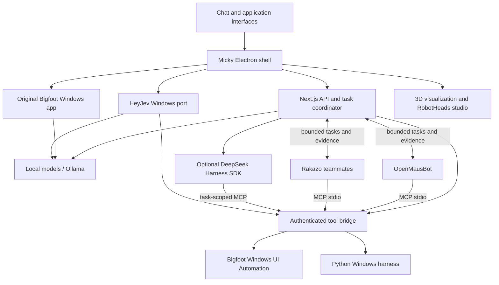

# Micky — local Windows agent desktop

Micky is an Electron desktop assistant that connects local language models, Windows computer tools and several open-source agent applications. You can chat, run tasks, inspect progress, switch to each application's interface and view the system's live architecture graph.

The applications keep their own engines and data. Micky connects them through authenticated local bridges, managed agents and a shared model service. This is a coordinated application system; it does not combine model weights into a new model.

## Architecture and integration guides

- [Full architecture, modules, bridges and task lifecycle](docs/ARCHITECTURE.md)
- [Upstream integrations, exact revisions and Windows adaptations](docs/INTEGRATIONS.md)
- [Installation and local configuration](docs/INSTALLATION.md)
- [Verification, current behavior and implementation limits](docs/STATUS.md)
- [Third-party source and attribution](THIRD_PARTY_NOTICES.md)



## What is included

| Component | Role in Micky |
| --- | --- |
| Micky | Main chat, task state, coordination, application switching and progress |
| OpenMausBot | Bot workspace, teams, memory/skills/schedules, browser and MCP tools |
| Rakazo | Persistent teammates, conversations, routines, local database and agent runtime |
| Bigfoot | Native Windows controls; original desktop app with chat, drawing, plugins and terminal |
| HeyJev | Windows port of its original command, timer, recorder and dictation engine; local speech |
| DeepSeek Harness SDK | Optional planning, reasoning and tool loop using local models |
| RobotHeads | Editable robot avatar visual component |

Munder has been removed from the active system. Legacy chat history is not published.

## Windows setup

Prerequisites: Git, Node.js 24, Python with Tk support, Ollama, and pnpm 9.15 for Rakazo. Bigfoot's native helper build also needs a compatible C# compiler; see its pinned upstream build script.

```powershell
git clone --recurse-submodules https://github.com/pali2410/micky.git
cd micky
node scripts/prepare-upstreams.cjs
Copy-Item .env.example .env.local
npm ci
python -m pip install -r requirements.txt
```

Apply the patches **before** building upstream applications. Follow [the installation guide](docs/INSTALLATION.md) for their dependencies, builds, speech models and runtime requirements. Downloaded binaries, models, databases, credentials and user conversations are intentionally excluded from Git.

```powershell
$env:MICKY_BUILD_DIR = '.next-native'
npm run build
npm run app
```

From the sidebar, **Open Bigfoot** and **Open HeyJev** launch their actual application windows. HeyJev offers continuous listening, wake phrase and push to talk. Its Dictionary, Apps, Dictation history, Privacy, Settings and Local models pages run in a native Windows interface.

## Local models

Choose installed models for chat, execution, reasoning and vision. The application defaults use Qwen2.5 3B for the newly connected native apps because its command routing and structured tool calls were verified. Bigfoot uses a separate installed vision model to describe screenshots for a tool-capable text model. Both native apps expose local model selection.

Changing the provider endpoint or choosing a different model does not guarantee that model can follow tool schemas or interpret screenshots correctly. The model-role router, specialist consultation and task coordination are the implemented “Super Brain” layer.

## Progress and verification

Tasks remain within their parent conversation instead of creating a new sidebar bot for each task. The coordinator records queued, running, waiting, completed, failed and cancelled work, and collects evidence from connected applications. A queued task or typed message draft is not a completed action.

Representative checks:

```powershell
npx tsc --noEmit
node tests/worker-regression.cjs
node tests/native-integrations.cjs
node tests/system-graph.cjs
node tests/native-app-providers.cjs
npm --prefix Bigfoot test
```

The native provider check requires the documented local models and running Ollama. See [STATUS](docs/STATUS.md) for which checks were run and which features still need broader testing. This repository does not claim universal desktop-task reliability or kernel-level control.
