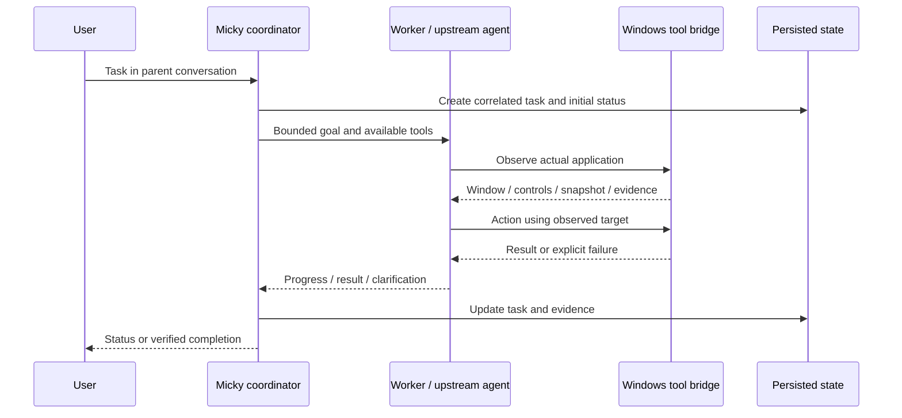

# Micky architecture

This guide describes the source snapshot published with this repository. Pinned upstream revisions are recorded in `integrations/upstreams.json`; local modifications are versioned as patches and overlay files. Features described as optional or experimental are not implied to be enabled by default.

## 1. System boundaries

Micky is a Windows user-space desktop application. Electron owns the desktop window and starts local services. Next.js provides the React interface and server-side coordinator. Python and Bigfoot's compiled C# helper provide actual Windows observations and actions. Separate upstream applications retain their own state, UI and execution loops.

The “Super Brain” is a software coordination layer: a model-role router, application registry, managed chiefs/specialists, task state and evidence ledger. It is not a new neural model, a fusion of downloaded model weights, or a kernel driver. Actions execute with the Windows user's permissions. Elevated permissions are not obtained automatically.

## 2. Source map

| Source | Responsibility |
| --- | --- |
| `desktop/main.cjs` | Electron lifecycle, local server startup, main window, overlay and application shutdown |
| `desktop/preload.cjs` | Restricted renderer-to-native IPC |
| `components/app/micky-app.tsx` | Main navigation, parent conversations and application surfaces |
| `components/app/native-integrations.tsx` | Launch and switch controls for real Bigfoot/HeyJev applications |
| `components/app/voice-control.tsx` | Micky's separate local voice-command entry point |
| `lib/server/store.ts` | Persisted Micky application/chat/task state |
| `lib/server/sessions.ts` | Task execution, planning, observations, cancellation and recovery |
| `lib/brain.ts` | Application/agent registry and migration rules |
| `lib/server/application-agents.ts` | Actual upstream chief/specialist provisioning |
| `lib/server/application-task.ts` | Bounded external assignments and completion collection |
| `lib/server/model-selection.ts` | Persisted selections for model roles |
| `lib/server/bridge-tools.ts` | Shared tool schemas, dispatch and policy checks |
| `lib/server/tool-policy.ts` | Approval state for actions requiring a decision |
| `lib/server/system-bridge.ts`, `lib/system-graph.ts` | Runtime observations and architecture graph |
| `desktop/bigfoot-runtime.cjs` | Exact-window native inspection/control and local speech adapter |
| `desktop/native-apps.cjs` | Native upstream app launch, process status and model configuration |
| `scripts/harness-server.py` | Python Windows execution and compatibility tools |
| `runtimes/openmaus/micky-mcp.cjs` | MCP stdio adapter for shared Windows tools |
| `runtimes/deepseek/` | Pinned optional SDK client, local model gateway and task-scoped tools |
| `runtimes/rakazo-host.mjs` | Rakazo API/web/worker processes and local PostgreSQL lifecycle |

## 3. Desktop startup

1. Electron loads local environment and model selections.
2. The shell checks/starts Ollama when using its normal local endpoint.
3. It starts the Python harness and Next renderer/API when needed.
4. Native Windows inspection and speech are initialized.
5. Maus and Rakazo start according to the persisted application configuration. Startup is sequential to reduce simultaneous build/memory spikes.
6. The coordinator provisions actual managed chiefs and records lifecycle results.
7. Bigfoot and HeyJev are launched on demand from the sidebar. Their actual Windows interfaces are separate application windows, rather than explanatory mock panels.

Each application failure is reported independently. A ready port is a runtime observation, not evidence that a user task succeeded.

## 4. Model roles and local inference

The default model transport is an OpenAI-compatible loopback endpoint, commonly Ollama at `http://127.0.0.1:11434/v1`. No paid AI provider key is required for the local configuration.

| Role | Use |
| --- | --- |
| Chat | Normal conversation and task interpretation |
| Execution/worker | Structured actions and bounded agent tasks |
| Reasoning | Consultation and bounded recovery suggestions |
| Vision | Screenshot/image interpretation when semantic controls are insufficient |

Role selections can route to different installed models. A model's answer is advisory until an executor performs the action and supplies observations. Model availability, model capabilities and task success are separate states.

For the new native apps, Qwen2.5 3B was selected after a real command-routing/tool-call check. Bigfoot's adapter can ask the installed vision model to describe a screenshot, then present that observation to a text model that supports function calls. Screen element IDs come from semantic inspection, never from the vision model inventing them. The local provider preserves Bigfoot's coordinate conversion contract.

The model service is shared, but conversations are not automatically pooled into a single context. Large-model memory use and competing requests can affect latency. The visualization does not show hidden reasoning or neural weights.

## 5. Task lifecycle and parallel work

Task workers stay associated with their parent chat; a task does not create another top-level sidebar conversation. Multiple workers can plan or research independently. Focus-sensitive mouse/keyboard operations must serialize against the one desktop, so parallel planning does not mean simultaneous typing into the same foreground window.

The coordinator carries task identity and request correlation through external delegation. It records errors, timeouts, waiting-for-input and cancellation. Chiefs receive bounded assignments and are instructed not to delegate back into an infinite Micky loop. The old Munder application is not registered; migration prevents unfinished legacy assignments from replaying as a different engine.

Normal chats, deterministic common workflows, native planning and optional DeepSeek execution are distinct routes. A failed experimental planner can fall back to the local structured planner. Recovery is bounded; it must use actual observations rather than repeatedly issuing the same unverified mutation.

## 6. Shared Windows tool bridge

`/api/bridge` exposes schemas and executes tools for authenticated local clients. A random bridge token is stored locally, passed to the managed MCP process and excluded from Git. The public schemas include:

- `windows`, `applications`, `desktop`: real window/application discovery and metadata.
- `inspect`, `control`: observed semantic controls and snapshot-bound actions.
- `open`, `chrome`: application/file/URL opening and Chrome-profile operations.
- `files`, `shell`: file inspection and Windows scripting.
- `web`, `spreadsheet`: website reading and workbook creation/verification.
- `whatsapp`: explicit recipient, message, read/send parameters and request identity.
- `micky_status`, `rakazo_status`, `rakazo_thread`, `rakazo_message`: shared task/application visibility and bounded teammate work.

Maus and Rakazo receive the same Windows tools through MCP. Micky's own workers can use the corresponding executor directly. The Bigfoot native adapter is preferred for matching observations; unsupported cases may use the compatibility harness. Each route must retain the evidence/approval semantics of the bridge.

The native control contract binds actions to an observed window and a recent snapshot. Typing reads back the field value; stale snapshots cannot authorize a new action. Provider retries are not blanket authorization to replay a message send or file mutation. A typed WhatsApp draft is not proof of sending.

## 7. How each application connects

### OpenMausBot

`desktop/openmaus.cjs` starts the pinned server and serves its built UI. First-run configuration selects the local compatible provider and registers the Micky MCP server. Managed chiefs/specialists have real upstream bot identities. Maus retains its bots, memory, skills, schedules, teams and browser state in `.data/openmaus`.

Windows changes adjust local-only settings, browser handling and desktop shell integration. Existing upstream platform-specific computer/call implementations are not all certified on Windows. The browser remains an upstream browser feature, while shared native Windows actions cross the Micky bridge.

### Rakazo

`desktop/rakazo-native.cjs` and `runtimes/rakazo-host.mjs` run API, web and worker processes with persistent embedded PostgreSQL. A local session adapter creates/reuses a machine-local identity, registers the Windows MCP server and assigns it to actual teammates. Local-provider patches select installed models and suppress unnecessary cloud setup in Micky's deployment mode.

Rakazo retains its own database, conversations, teammates and routines. The bridge queues assignments with correlation IDs; a queued reply is not a finished result. Database binaries and user databases are downloaded/generated locally, not committed.

### Bigfoot

Two connections coexist: its compiled Windows UI Automation helper serves Micky's native controls, and its original desktop application runs with its own chat, cursor companion, drawing/math tools, plugins, settings and terminal.

The added `MickyRuntime` uses the existing local model service. It does not download another LLM or terminate Ollama when Bigfoot stops. Local model selectors replace cloud setup in the Micky launch mode. Original standalone provider behavior remains available outside that mode.

### HeyJev

The Windows port keeps the upstream `siri.py` command decision flow, timers, Recorder, wake/PTT loop and chunked Dictation class. `windows_app.py` replaces Cocoa with a native Tk interface. `windows_backend.py` replaces TypeSafe/OpenRouter/Fish and AppleScript with local LLM decisions, local Whisper small.en, Windows speech and native/bridge actions.

The interface includes Home, Dictionary, Apps, Dictation history, Privacy, Settings and Local models. Continuous listening is added alongside wake phrase and push to talk. Dictionary corrections and local dictation history are persisted. This is an adapted Windows application, not Cocoa executing on Windows.

### DeepSeek Harness

The pinned npm SDK is optional; installing the harness does not install a DeepSeek language model. `lib/server/deepseek.ts` delegates planning/advice/execution to the owned stdio SDK process. A local gateway connects the SDK provider to installed models. Task-specific MCP tools carry the execution token and tools available to that task.

Primary planner, reasoning and execution flags are independent. The pinned SDK uses session status/events to settle turns. Failures and model JSON are validated before Micky's Windows executor acts. This is a selected SDK integration, not every upstream plugin or experimental computer/voice provider enabled wholesale.

### RobotHeads and visualization

RobotHeads supplies avatar rendering/customization. The 3D system view renders application/agent/model relationships from service health, configured routes, active tasks and persisted events. Connections represent runtime architecture and work status, not a scientific view of the models' neural activity.

## 8. Persistence and memory

| Location | Local content |
| --- | --- |
| `.data/state.json` | Micky chats, tasks, application/agent registry and events |
| `.data/model-selection.json` | Model role selections |
| `.data/bridge-token` | Generated local bridge credential |
| `.data/openmaus/` | Maus configuration and upstream bot data |
| `.data/rakazo/` | Local identity, persistent database and workspace data |
| `.data/bigfoot/` | Original Bigfoot profile, settings and conversation data |
| `.data/heyjev/` | Windows preferences, vocabulary, dictation history and speech models |
| `.data/deepseek/` | Optional SDK sessions |
| `.logs/` | Per-service diagnostics |

Each engine retains its own memory semantics. Shared status queries and evidence collection provide cross-application coordination; this is not automatic semantic synchronization of every application's long-term memory. Local storage can contain private text or screenshots and should not be published.

## 9. Ports and trust boundaries

| Default endpoint | Function |
| --- | --- |
| `localhost:3000` | Micky renderer and coordinator API |
| `127.0.0.1:11434` | Ollama inference/catalog |
| `127.0.0.1:8766` | Python harness; use matching `BOPS_HARNESS_URL` |
| `127.0.0.1:8769` | Authenticated native Windows/speech adapter |
| `127.0.0.1:8799` | Maus server/UI |
| `127.0.0.1:8800` | Maus webhook service |
| `127.0.0.1:3100` | Rakazo API |
| `127.0.0.1:5173` | Rakazo UI |
| `127.0.0.1:5433` | Embedded local PostgreSQL |
| `LAN:8812` | Optional phone gateway when enabled |

Model and computer services are intended for loopback access. The optional phone gateway deliberately exposes a LAN entry point and must be considered separately. Android control uses the device-specific bridge/ADB path; remote phone access and controlling an Android device are different functions. End-to-end phone/browser/platform coverage still needs broader verification.

Renderer IPC checks the owning window/frame. External pages, messages and websites are observations, not trusted instructions. Approval policy is evaluated before consequential tools; completion is tied to evidence, not a model's assertion. These controls reduce mistakes but are not a proof of universal reliability or a substitute for OS security.
